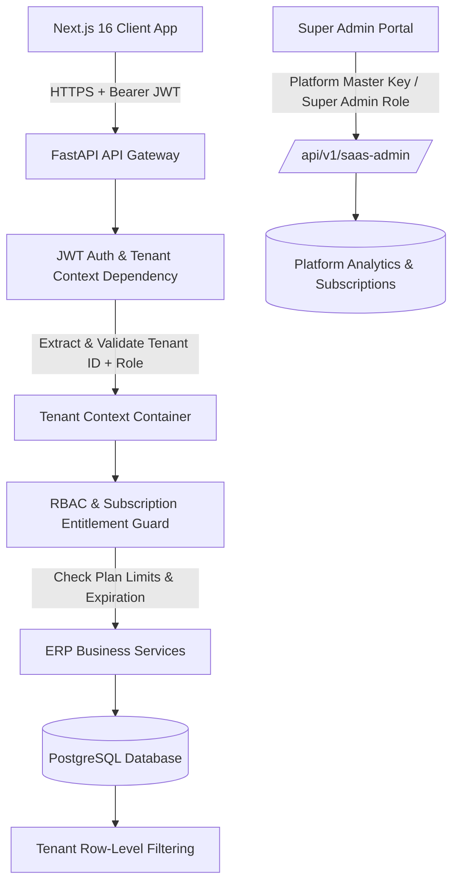
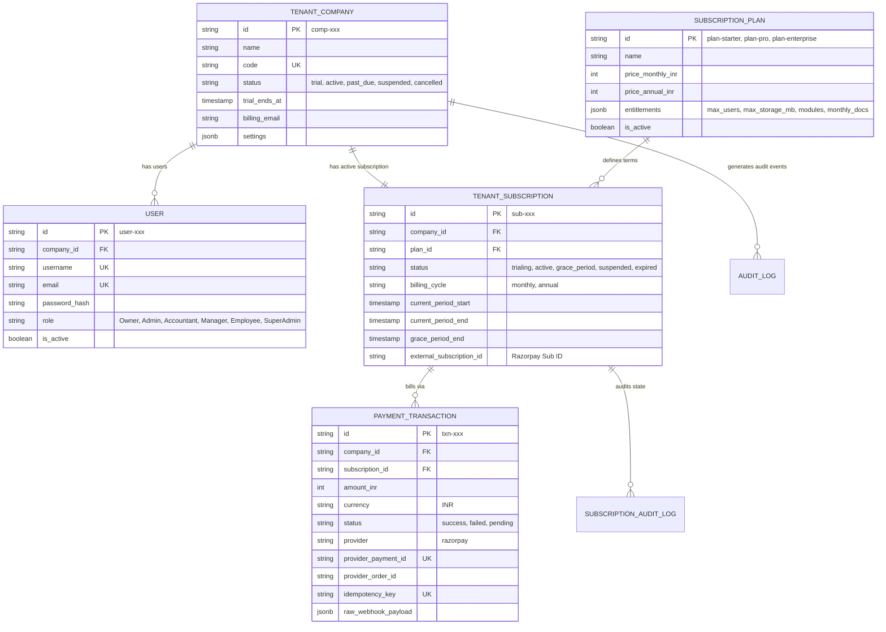

# OM SAI ERP — Commercial Multi-Tenant SaaS Architecture Blueprint

**Platform:** Om Sai Textile ERP (TexaFlow)  
**Architecture Model:** Shared Application, Shared Database with Row-Level Tenant Isolation & Context Enforcement  
**Target Market:** Commercial Textile Manufacturers, Embroidery Jobwork Units, Weaving Mills & Garment Exporters  
**Primary Anchor Tenant:** Om Sai Enterprise – OSE House (Operates as Standard Tenant without privileged bypasses)  

---

## 1. Architectural Strategy & Tenant Context

### 1.1 Tenant Resolution Rules
1. **Authoritative Source:** The active tenant company identifier (`company_id`) is strictly extracted from the cryptographically verified JWT claims (`payload["company_id"]`).
2. **Zero Frontend Trust:** Neither `company_id` in request query strings, JSON payloads, nor `X-Company-Id` headers can override the authenticated token. Mismatched client headers trigger an immediate `HTTP 403 Forbidden`.
3. **No Special Privileges:** Om Sai Enterprise (OSE House) operates on the standard `comp-xxx` tenant schema and subscribes to standard plans with zero hardcoded backdoors.

---

## 2. SaaS Database Schemas & Models

---

## 3. Subscription Lifecycle & Grace Period Matrix

| Subscription Status | ERP Read Access | ERP Create/Update Access | Export Data | Grace Period Behavior |
|---|---|---|---|---|
| **Trialing** (14 Days) | Full | Full (Within Plan Limits) | Allowed | Countdown displayed in navigation bar |
| **Active** (Paid) | Full | Full (Within Plan Limits) | Allowed | Standard uninterrupted service |
| **Past Due / Failed** | Full | Full (Warning banner) | Allowed | 7-Day Grace Period starts |
| **Grace Period** | Full | Limited (Cannot add new employees or branches) | Allowed | Prominent "Renew Subscription" modal |
| **Suspended / Expired** | Read-Only | Blocked (HTTP 402 Payment Required) | Allowed | Data preserved intact; renewal required |
| **Cancelled** | Read-Only (30 Days) | Blocked | Allowed | Soft-locked; retained per retention policy |

---

## 4. RBAC Permission Matrix

| Role | Financials (Invoices, Purchases) | Parties & Vendors | HRMS & Salary | Settings & Bank Details | Subscription & Billing | User Management |
|---|---|---|---|---|---|---|
| **Owner** | Full (CRUD + Export) | Full | Full | Full | Full | Full |
| **Admin** | Full | Full | Full | View & Edit Profile | View Only | Full |
| **Accountant** | Full | View & Edit | View Only | View Bank | No Access | No Access |
| **Manager** | View & Create Challans | View Only | Attendance Only | No Access | No Access | No Access |
| **Employee** | No Access | No Access | Self Punch Only | No Access | No Access | No Access |
| **SuperAdmin** | Platform Master | Platform Master | Platform Master | Platform Master | Platform Master | Platform Master |

---

## 5. Implementation Roadmap (Phases)

- **Phase 1: Database Architecture & Core Models**
  - Setup Alembic migration infrastructure.
  - Implement `SubscriptionPlan`, `TenantSubscription`, `PaymentTransaction`, `AuditLog`.
  - Add explicit `role` enum and `is_active` fields to `00_auth_users`.
- **Phase 2: Tenant Context & Entitlement Guards**
  - Implement centralized `TenantContext` dependency with subscription status checking.
  - Create `@require_permission` and `@enforce_entitlement` decorators for API routes.
- **Phase 3: Company Onboarding & Self-Service Registration**
  - Modernized registration flow with email OTP validation and automated 14-day trial provisioning.
  - Company settings initialization with independent invoice prefixing.
- **Phase 4: Billing & Provider Abstraction (Razorpay Webhooks)**
  - Abstract `PaymentGatewayProvider` interface.
  - Webhook endpoint with HMAC-SHA256 signature verification and idempotency protection.
- **Phase 5: Super Admin Platform Management**
  - Dedicated Super-Admin backend router (`/api/v1/saas-admin`).
  - Company directory, subscription oversight, manual extension/suspension controls, and audit logs.
- **Phase 6: Automated Multi-Tenant & SaaS Test Suite**
  - Unit and integration tests verifying strict cross-tenant isolation, expired subscription blocking, and webhook replay protection.
